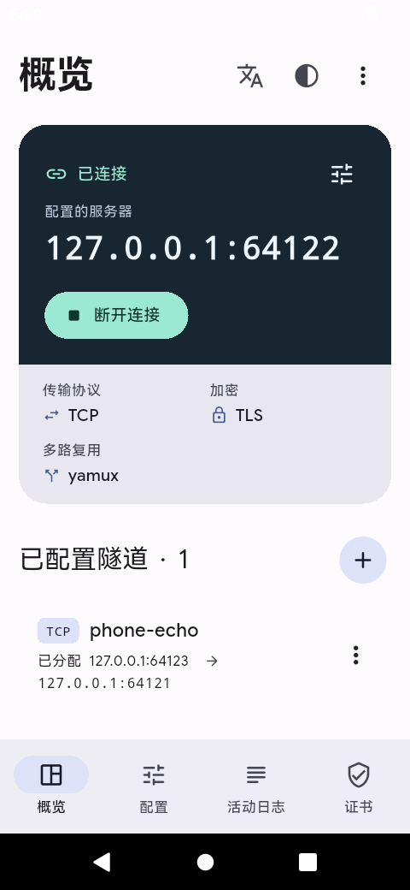
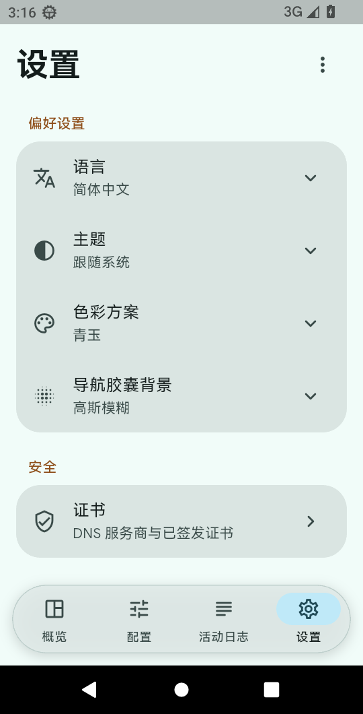

# Astrave

[English](README.md)

Astrave 通过你管理的服务器发布本地服务。Rust 客户端主动连接服务器，访问者连到指定端口或虚拟主机后，服务器将流量沿隧道转发给本地服务。Android、Windows、Linux 和 macOS 上的 Flutter 应用与命令行共用同一个 Rust 客户端。


## 在一台机器上试用

准备 Rust 1.95.0，在项目根目录打开三个终端。示例将 `8000` 端口上的 HTTP 服务映射到 `9000` 端口，控制连接和映射端口都只监听本机回环地址。在第一个终端启动 Rust 文档预览服务，它监听 `8000` 端口。

```sh
cargo run --locked --features docs --bin astrave-docs -- --serve
```

在第二个终端启动服务端，再在第三个终端启动客户端。

```sh
cargo run --locked --bin astrave-server -- -c conf/astrave-server.toml
```

```sh
cargo run --locked --bin astrave -- -c conf/astrave.toml
```

打开 `http://127.0.0.1:9000/img/logo.png`，浏览器会通过隧道收到由 `8000` 端口提供的图标。要试用桌面端，先停止命令行客户端，在桌面端的「配置」页打开 `conf/astrave.toml`，然后在「概览」页点击「连接」。

## Android 手机客户端




使用 Flutter 3.47.9、JDK 17、Android SDK（API 36）和 NDK 28.2.13676358。在 `app/` 目录执行以下命令，按处理器架构构建 APK。最低系统版本为 Android 7.0（API 24）。

```sh
rustup target add --toolchain 1.95.0 aarch64-linux-android armv7-linux-androideabi x86_64-linux-android
flutter pub get --enforce-lockfile
flutter build apk --release --split-per-abi
```

现代 ARM64 手机可安装 `app/build/app/outputs/flutter-apk/app-arm64-v8a-release.apk`。本地构建默认使用开发签名。在「配置 → 导入配置」中选择 TOML 文档，检查后点「校验并保存」，应用会保存自己的副本。手机配置里的 `127.0.0.1` 指手机自身。通过 USB 试用电脑上的回环示例时，先执行 `adb reverse tcp:9527 tcp:9527` 和 `adb reverse tcp:8000 tcp:8000`。

可导入的 UTF-8 TOML 文件上限为 2 MiB。导入只复制配置文本，证书和私钥路径应指向手机上应用可读取的文件。服务器使用公开受信任的证书时，留空 `trustedCaFile` 即可使用 Android 系统信任库。

Android 隧道在应用进程中运行。切到后台或进入省电休眠后，系统可能暂停或终止连接。返回「概览」可查看当前状态。

## 桌面客户端

使用 Flutter 3.47.9、对应平台的 Flutter 桌面构建工具和项目固定的 Rust 工具链。在 Windows 上进入 `app/` 目录执行以下命令。在 Linux 或 macOS 上将构建目标改为 `linux` 或 `macos`。

```sh
flutter pub get --enforce-lockfile
flutter build windows --release
```

在 Windows x64 上运行 `app/build/windows/x64/runner/Release/astrave_desktop.exe`。分发时保留完整的 `Release` 目录，其中包含 Rust 动态库、Flutter 引擎和 `data/` 资源。

| 页面 | 用途 |
| --- | --- |
| 概览 | 连接或断开会话，添加或编辑隧道，复制服务端实际分配的端点。 |
| 配置 | 直接编辑 TOML 并保留注释，校验和保存后可重载运行中的客户端。 |
| 活动日志 | 筛选或清空最近 500 条会话日志。 |
| 设置 | 选择 15 种界面语言、调整主题、检查 GitHub 更新，或打开证书管理和关于页面。 |

「设置 → 关于 Astrave」显示进程 CPU 占用、驻留内存和当前连接时长。桌面端可选择「隐藏到托盘」让客户端继续运行，再从托盘菜单恢复窗口。[外观、在线更新和 DNS-01 配置](docs/zh/desktop.md)

要从另一台主机的回环端口访问 Magpie、sub2api 等服务，可部署发布端、消费端和会合服务。端点互相核对证书指纹，再通过直连转发 TCP 流量。[P2P 配置及 systemd 单元](docs/zh/transport/peer.md)

## 部署

本机示例使用明文 TCP。跨主机部署时，在两端配置相同的 `auth.token`，在服务端设置 `transport.tls.force = true` 并提供 `certFile` 和 `keyFile`，在客户端启用 `transport.tls.enable`。客户端默认使用系统信任库校验服务端证书链和名称。使用私有 CA 时，在客户端指定 `transport.tls.trustedCaFile`。在**服务端**设置这个字段会启用客户端证书认证，此时客户端也需要提供证书和私钥。根据要开放的网卡显式配置 `listen` 和 `proxyAddr`。

Rust 客户端支持 TCP、UDP、HTTP、HTTPS 和 SOCKS5 隧道，传输层可选 TCP、WebSocket、KCP 或 QUIC。协议参数、TLS 与多路复用选项见完整示例。[客户端配置](conf/astrave-full.toml) · [服务端配置](conf/astrave-server-full.toml)

浏览器管理面板由 Rust 服务端直接生成。在 `[dashboard]` 中设置回环地址、端口、用户名和密码，即可查看客户端、隧道和流量。需要远程管理时，通过 HTTPS 反向代理访问。

```sh
cargo build --release --locked --bin astrave --bin astrave-server
```

## 源码目录

`astrave` 是唯一的 Cargo 包。所有 Rust 源文件都直接放在 `rust/src/`。阅读库从 `lib.rs` 开始，阅读可执行程序可从下表的入口开始。相关文件通过 `mod` 组织，例如管理面板的实现集中在 `server_dashboard*.rs`。

默认的 `cli` feature 构建客户端和服务端，Flutter 构建钩子通过 `app` feature 生成 `astrave_desktop` 原生库。单独构建文档生成器可运行 `cargo build --locked --no-default-features --features docs --bin astrave-docs`。

| 路径 | 职责 |
| --- | --- |
| `rust/src/proto.rs`、`rust/src/core.rs` | 线协议、编解码、认证、传输和配置的模块入口 |
| `rust/src/client.rs`、`rust/src/astrave.rs`、`rust/src/server.rs` | Rust 客户端与命令行程序入口 |
| `app/`、`rust/src/api.rs` | Material 3 Expressive Flutter 界面及通过 `flutter_rust_bridge` 调用的 Rust 运行时 |
| `rust/src/server_dashboard.rs` | 服务端渲染的管理面板和 JSON API |
| `docs/`、`rust/src/docs.rs` | 中英文 Markdown、截图和 Rust 静态站点生成器 |

Windows 同负载的内存、吞吐、管理查询延迟，以及各路径的时间和空间复杂度见[性能测量](docs/zh/performance.md)。

## 发布版本

公网端口映射、私网组网的差异和网关重启实测见 [frp、Orbien 与 Tailscale 对比](docs/zh/comparison.md)。

例如，`app/pubspec.yaml` 使用 `version: 1.0.0+1` 时，`rust/Cargo.toml` 的包版本为 `1.0.0`，对应提交的 tag 为 `v1.0.0`，Flutter 构建号为 `1`。推送 tag 后，GitHub Actions 运行 Rust 和 Flutter 检查，构建命令行、桌面安装包和三种 Android APK。构建与容器镜像发布成功后，工作流自动创建 GitHub Release。手动重跑时，在 Release 工作流中选择同一个 tag。

Android 签名使用仓库密钥 `ANDROID_KEYSTORE_BASE64`（以 Base64 编码的发布密钥库）、`ANDROID_STORE_PASSWORD`、`ANDROID_KEY_ALIAS` 和 `ANDROID_KEY_PASSWORD`。升级已安装的应用需要沿用相同的签名密钥。

## 许可证

Apache License 2.0。[许可证全文](LICENSE)

桌面端使用 Google Sans 和 HarmonyOS Sans 字体。在「关于 Astrave」中可阅览随应用分发的字体许可证。[Google Sans 许可证](app/assets/fonts/GoogleSans-OFL.txt) · [HarmonyOS Sans 许可证](app/assets/fonts/HarmonyOS-Sans-License.txt)
