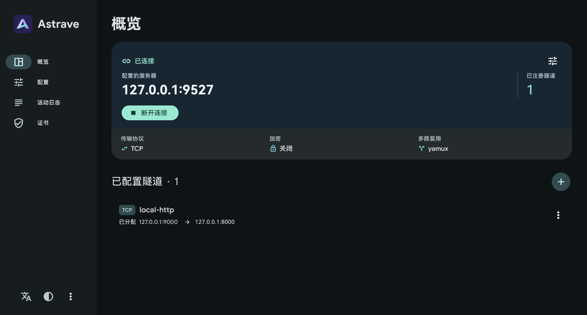

# Astrave

[English](README.md)

Astrave 通过你管理的服务器发布本地服务。Rust 客户端主动连接服务器，访问者连到指定端口或虚拟主机后，服务器将流量沿隧道转发给本地服务。Flutter 桌面端与命令行共用同一个 Rust 客户端。



## 在一台机器上试用

准备 Rust 1.95.0，在项目根目录打开三个终端。示例将 `8000` 端口上的 HTTP 服务映射到 `9000` 端口，控制连接和映射端口都只监听本机回环地址。在第一个终端启动 Rust 文档预览服务，它监听 `8000` 端口。

```sh
cargo run --locked -p astrave-docs -- --serve
```

在第二个终端启动服务端，再在第三个终端启动客户端。

```sh
cargo run --locked -p astrave-server -- -c conf/astrave-server.toml
```

```sh
cargo run --locked -p astrave-client -- -c conf/astrave.toml
```

打开 `http://127.0.0.1:9000/img/logo.png`，浏览器会通过隧道收到由 `8000` 端口提供的图标。要试用桌面端，先停止命令行客户端，在桌面端的「配置」页打开 `conf/astrave.toml`，然后在「概览」页点击「连接」。

## 桌面客户端

使用 Flutter 3.47.9、对应平台的 Flutter 桌面构建工具和项目固定的 Rust 工具链。在 Windows 上进入 `app/` 目录执行以下命令。在 Linux 或 macOS 上将构建目标改为 `linux` 或 `macos`。

```sh
flutter pub get --enforce-lockfile
flutter build windows --release
```

在 Windows x64 上运行 `app/build/windows/x64/runner/Release/astrave_desktop.exe`。分发时保留完整的 `Release` 目录，其中包含 Rust 动态库、Flutter 引擎和 `data/` 资源。

| 页面 | 用途 |
| --- | --- |
| 概览 | 连接或断开会话，添加或编辑隧道，复制服务端实际分配的端点。 |
| 配置 | 直接编辑 TOML 并保留注释，校验和保存后可重载运行中的客户端。 |
| 活动日志 | 筛选或清空最近 500 条会话日志。 |
| 证书 | 管理 Cloudflare、阿里云或腾讯云的 DNS 凭据，通过 DNS-01 申请 Let’s Encrypt 证书。 |

在「更多」菜单中打开「关于 Astrave」，可查看进程 CPU 占用、驻留内存和当前连接时长。使用带系统托盘的桌面时，可选择「隐藏到托盘」让客户端继续运行，再从 Astrave 托盘菜单恢复窗口。语言和主题设置会保存在本机。

## 部署

本机示例使用明文 TCP。跨主机部署时，在两端配置相同的 `auth.token`，在服务端设置 `transport.tls.force = true` 并提供 `certFile` 和 `keyFile`，在客户端启用 `transport.tls.enable`。客户端默认使用系统信任库校验服务端证书链和名称。使用私有 CA 时，在客户端指定 `transport.tls.trustedCaFile`。在**服务端**设置这个字段会启用客户端证书认证，此时客户端也需要提供证书和私钥。根据要开放的网卡显式配置 `listen` 和 `proxyAddr`。

Rust 客户端支持 TCP、UDP、HTTP、HTTPS 和 SOCKS5 隧道，传输层可选 TCP、WebSocket、KCP 或 QUIC。协议参数、TLS 与多路复用选项见完整示例。[客户端配置](conf/astrave-full.toml) · [服务端配置](conf/astrave-server-full.toml)

浏览器管理面板由 Rust 服务端直接生成。在 `[dashboard]` 中设置回环地址、端口、用户名和密码，即可查看客户端、隧道和流量。需要远程管理时，通过 HTTPS 反向代理访问。

```sh
cargo build --release --locked -p astrave-server -p astrave-client
```

## 源码目录

| 路径 | 职责 |
| --- | --- |
| `proto/`、`core/` | 线协议、编解码、认证、传输和配置 |
| `client/`、`server/` | Rust 客户端、命令行、隧道路由和管理面板 API |
| `app/`、`desktop/` | Material 3 Expressive Flutter 界面及通过 `flutter_rust_bridge` 调用的 Rust 运行时 |
| `server/src/dashboard/` | 服务端渲染的管理面板和 JSON API |
| `docs/` | 中英文 Markdown、截图和 Rust 静态站点生成器 |

Windows 同负载的内存、吞吐、管理查询延迟，以及各路径的时间和空间复杂度见[性能测量](docs/zh/performance.md)。

## 许可证

Apache License 2.0。[许可证全文](LICENSE)

桌面端使用 Google Sans 和 HarmonyOS Sans 字体。在「关于 Astrave」中可阅览随应用分发的字体许可证。[Google Sans 许可证](app/assets/fonts/GoogleSans-OFL.txt) · [HarmonyOS Sans 许可证](app/assets/fonts/HarmonyOS-Sans-License.txt)
