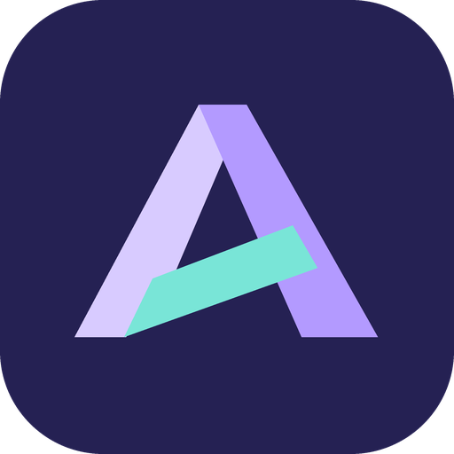
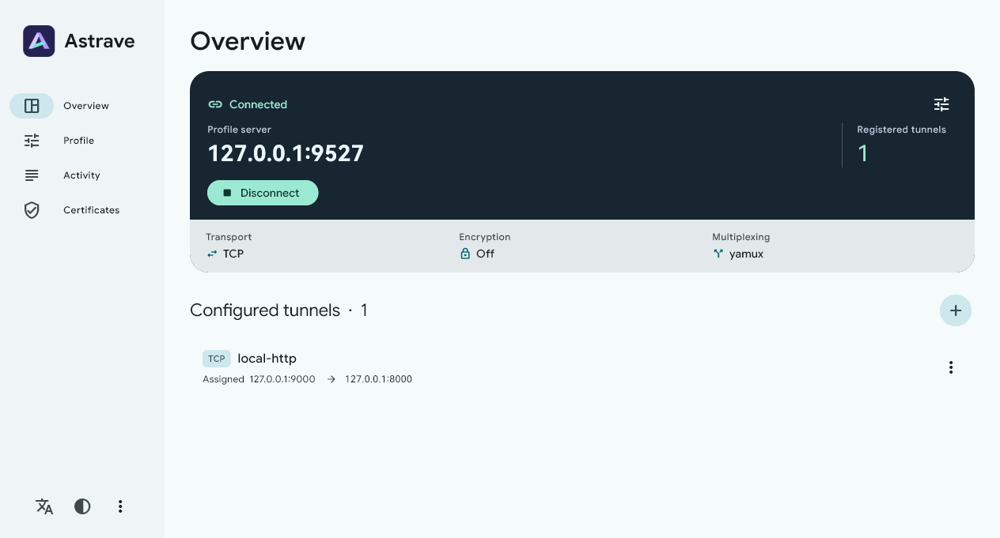
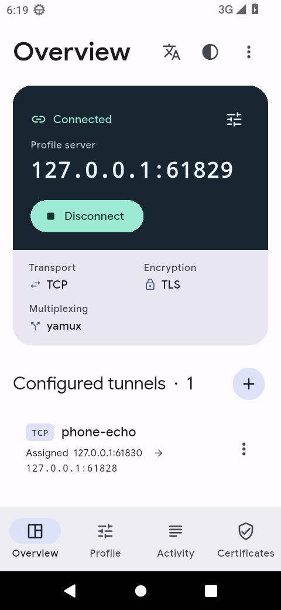
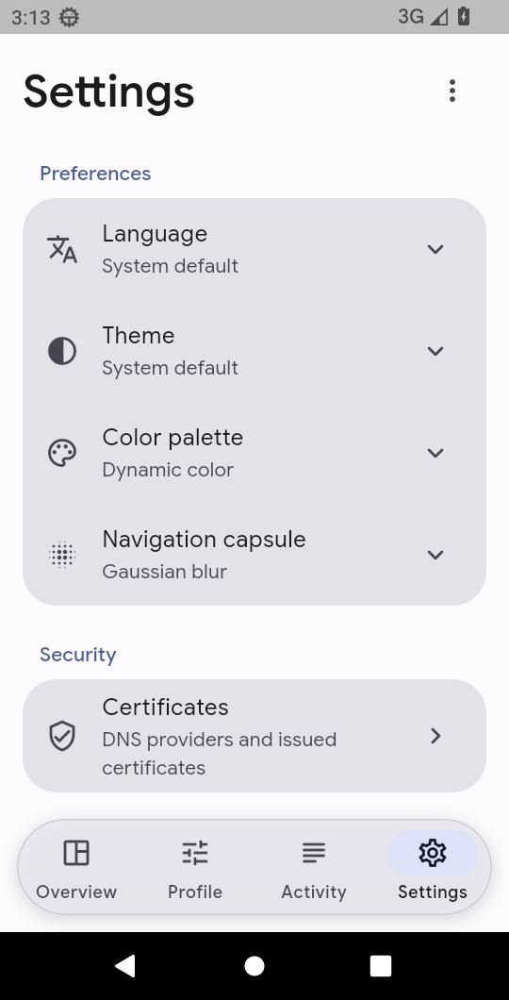

# Astrave

[简体中文](README-zh.md)

Astrave publishes local services through a server you control. The Rust client opens an outbound connection to the server. Incoming connections to a configured port or virtual host travel back through that connection to the local service. The Flutter app on Android, Windows, Linux and macOS shares its Rust client with the command line.



## Try a tunnel on one machine

You need Rust 1.95.0 and three terminals in the project root. The example publishes a local HTTP service on port `8000` through port `9000`. Both the control connection and the published port bind to loopback. In the first terminal, start the Rust documentation preview on port `8000`.

```sh
cargo run --locked --features docs --bin astrave-docs -- --serve
```

Start the server in the second terminal and the client in the third.

```sh
cargo run --locked --bin astrave-server -- -c conf/astrave-server.toml
```

```sh
cargo run --locked --bin astrave -- -c conf/astrave.toml
```

Open `http://127.0.0.1:9000/img/logo.png`. The browser receives the image from port `8000` through the tunnel. To try the desktop client, stop the CLI client, open `conf/astrave.toml` under **Profile**, then select **Connect** in **Overview**.

## Android




From `app/`, use Flutter 3.47.9, JDK 17, the Android SDK (API 36) and NDK 28.2.13676358. Build the per-ABI APKs for Android 7.0 (API 24) and later:

```sh
rustup target add --toolchain 1.95.0 aarch64-linux-android armv7-linux-androideabi x86_64-linux-android
flutter pub get --enforce-lockfile
flutter build apk --release --split-per-abi
```

For a modern ARM64 phone, install `app/build/app/outputs/flutter-apk/app-arm64-v8a-release.apk`. Local builds use a development signing key by default. In **Profile → Import profile**, select a TOML document, review it and choose **Validate & save**. The app keeps its own copy. A service at `127.0.0.1` runs on the phone. For a USB test against the loopback example on your computer, run `adb reverse tcp:9527 tcp:9527` and `adb reverse tcp:8000 tcp:8000` first.

Import accepts UTF-8 TOML up to 2 MiB. Only the TOML is imported. Certificate and key paths must resolve to files the app can read on the phone. For a server with a publicly trusted certificate, leave `trustedCaFile` unset to use Android’s system trust store.

The Android tunnel runs in the app process. Android can suspend or end the connection in the background or during Doze. Open Overview to see its current state.

## Desktop

Use Flutter 3.47.9, the platform's Flutter desktop build tools and the pinned Rust toolchain. From `app/`, run the following on Windows. Use `linux` or `macos` as the build target on those hosts.

```sh
flutter pub get --enforce-lockfile
flutter build windows --release
```

On Windows, launch `app/build/windows/x64/runner/Release/astrave_desktop.exe` on x64 systems. Distribute the entire `Release` directory, including the Rust library, Flutter engine and `data/` assets.

| View | What you can do |
| --- | --- |
| Overview | Connect or disconnect, add or edit a tunnel, and copy its assigned endpoint. |
| Profile | Edit TOML directly, preserve comments, validate changes, save and reload the running client. |
| Activity | Search the most recent 500 entries and filter by INFO, WARN or ERROR. |
| Settings | Choose from 15 languages, adjust the theme, check GitHub Releases, or open Certificates and About Astrave. |

**Settings → About Astrave** shows process CPU usage, resident memory and session uptime. On desktops with a system tray, use **Hide to tray** to keep the client running and reopen it from the tray menu. [Appearance, updates and DNS-01](docs/en/desktop.md)

## Deployment

To reach a service such as Magpie or sub2api through a private loopback port on another host, configure a publisher, a consumer and a rendezvous. Each peer checks the other’s certificate fingerprint before forwarding TCP streams. [Peer configuration and systemd unit](docs/en/transport/peer.md)

The loopback example uses plaintext TCP. For a remote deployment, configure the same `auth.token` on both peers, set `transport.tls.force = true` on the server, and supply its `certFile` and `keyFile`. Enable `transport.tls.enable` on the client. The client verifies the server name and certificate chain using the host trust store by default. Set the client’s `transport.tls.trustedCaFile` for a private CA. Setting that field on the **server** enables client-certificate authentication and requires a corresponding client certificate and key. Choose `listen` and `proxyAddr` explicitly for the interfaces you intend to publish on.

The Rust client supports TCP, UDP, HTTP, HTTPS and SOCKS5 tunnels with TCP, WebSocket, KCP or QUIC transports. See the full client and server examples for protocol-specific options, TLS and multiplexing. [Client configuration](conf/astrave-full.toml) · [Server configuration](conf/astrave-server-full.toml)

The server renders the browser dashboard in Rust. Set a loopback address, port, user and password under `[dashboard]`. Open that address to inspect clients, tunnels and traffic. Use HTTPS through a reverse proxy for remote administration.

To reach the gateway through Cloudflare Tunnel, select `transport.protocol = "wss"` on the client. It authenticates the public edge and the Astrave origin independently. `cloudflared` forwards upgrades to the gateway's loopback listener. [Cloudflare Tunnel configuration](docs/en/transport/protocol/websocket.md)

Configure a cloud VM, authenticated WSS reverse proxy or DNS-01 provider using the deployment guide. [Cloud gateways and DNS certificates](docs/en/cloud.md)

```sh
cargo build --release --locked --bin astrave --bin astrave-server
```

## Source layout

`astrave` is the only Cargo package. All Rust sources are direct children of `rust/src/`. Start at `lib.rs` for the library or at one of the program entry points below. Module declarations group related files, such as `server_dashboard*.rs` for the dashboard.

The default `cli` feature builds the client and server. The Flutter build hook selects `app` for the `astrave_desktop` native library. To build the documentation generator on its own, run `cargo build --locked --no-default-features --features docs --bin astrave-docs`.

The performance report includes the Windows measurements, time and space complexity and reproduction commands. [Performance report](docs/en/performance.md)

| Path | Responsibility |
| --- | --- |
| `rust/src/proto.rs`, `rust/src/core.rs` | Module entry points for wire messages, codecs, authentication, transports and configuration |
| `rust/src/client.rs`, `rust/src/astrave.rs`, `rust/src/server.rs` | Rust agent and command-line entry points |
| `app/`, `rust/src/api.rs` | Material 3 Expressive Flutter interface and Rust runtime exposed through `flutter_rust_bridge` |
| `rust/src/server_dashboard.rs` | Server-rendered web dashboard and JSON API |
| `docs/`, `rust/src/docs.rs` | English and Chinese Markdown, screenshots and Rust static site generator |

## Release versions

For deployment differences and measured gateway restart times, see the [comparison with frp, Orbien and Tailscale](docs/en/comparison.md).

For `version: 1.0.0+1` in `app/pubspec.yaml`, set the Cargo package version in `rust/Cargo.toml` to `1.0.0` and tag the release commit `v1.0.0`. Flutter uses `1` as the build number. A tag push starts Rust and Flutter checks, builds the CLI, desktop packages and three Android APKs, and publishes the GitHub Release after the builds and container images succeed. To rerun manually, select the same tag in the Release workflow.

Configure the repository secrets `ANDROID_KEYSTORE_BASE64` (base64-encoded release keystore), `ANDROID_STORE_PASSWORD`, `ANDROID_KEY_ALIAS` and `ANDROID_KEY_PASSWORD` for APK signing. Use the same signing key for updates to an installed app.

## License

Apache License 2.0. [License text](LICENSE)

The desktop app uses Google Sans and HarmonyOS Sans. Both font licenses are included in the app and available under **About Astrave → View licenses**. [Google Sans license](app/assets/fonts/GoogleSans-OFL.txt) · [HarmonyOS Sans license](app/assets/fonts/HarmonyOS-Sans-License.txt)

## Contributions and Support

Thank you to [lxien](https://github.com/lxien) for their foundational contributions to this project prototype. 

If you’d like to support my development work, please visit [Buy Me a Coffee](https://www.buymeacoffee.com/blueokanna) or [CryptoCurrency](https://github.com/blueokanna/ArcadiaPlus/blob/main/.github/tips.md)
